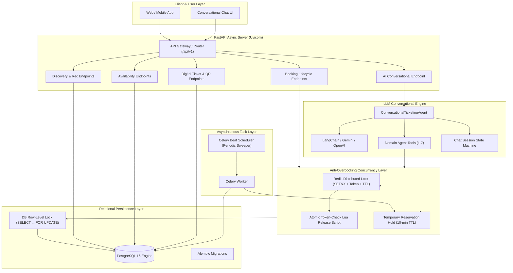
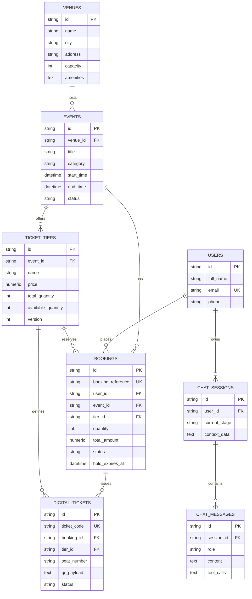

# 🎫 AI-Powered Online Ticketing & Booking Assistant
## Member 3: Backend & AI Architecture Specification & Implementation

[](https://fastapi.tiangolo.com)
[](https://www.postgresql.org)
[](https://redis.io)
[](https://python.langchain.com)
[](https://docs.celeryq.dev)
[](https://www.docker.com)

---

### 📌 Role & Scope
- **Member Focus**: FastAPI server, PostgreSQL DB schema, LLM AI agent, concurrency locks
- **Core Challenge**: High-demand ticket sales suffer from severe race conditions and inventory overbooking without distributed synchronization. This architecture solves overbooking with a multi-layered defense-in-depth concurrency lock, while empowering users with an intelligent multi-turn LLM assistant across the entire 7-stage customer booking lifecycle.

---

## 🏗️ 1. Architecture Overview



---

## 🔄 2. End-to-End Product Workflow (The 7-Stage Journey)

Our backend and AI agent strictly support and enforce each stage of the customer booking journey:

| Stage | Name | Description | Responsible Module / Endpoint | Concurrency & AI Handling |
|---|---|---|---|---|
| **1** | **Discovery** | User asks assistant to find an event or venue | `GET /api/v1/events`<br>`GET /api/v1/venues` | Keyword matching, city/date filtering, venue capacity check |
| **2** | **Recommendation** | Assistant presents suitable venues, events & ticket options | `GET /api/v1/events/recommendations` | Curated events ranked by proximity, category & date |
| **3** | **Availability** | System checks actual ticket inventory, dates and prices | `GET /api/v1/events/{id}/availability`<br>`GET /api/v1/tiers/{id}/availability` | Real-time query of `available_quantity` and sold-out states |
| **4** | **Selection** | User chooses ticket type, quantity (max 10) and available slot | AI State Machine & `POST /api/v1/bookings/reserve` | Validates requested quantity against remaining inventory |
| **5** | **Booking** | System validates details and processes the booking | `POST /api/v1/bookings/reserve` | **Distributed Redis Lock + DB `FOR UPDATE`**: atomic decrement, PENDING hold created |
| **6** | **Confirmation** | Booking recorded, and digital tickets generated | `POST /api/v1/bookings/confirm`<br>`GET /api/v1/tickets/{code}/qr` | Status flipped to `CONFIRMED`, unique ticket codes & signed QR payload issued |
| **7** | **Post-booking** | Retrieve ticket, track status, or request cancellation | `GET /api/v1/bookings/{ref}`<br>`POST /api/v1/bookings/cancel`<br>`POST /api/v1/tickets/verify` | Gate QR verification; Cancellation acquires distributed lock and releases seats back to inventory |

---

## 🛡️ 3. Concurrency Locks & Anti-Overbooking Engine

When high-demand tickets go on sale, thousands of simultaneous requests arrive for a finite number of seats. A simple `UPDATE ... SET available = available - 1` without concurrency locks leads to deadlocks, dirty reads, and severe overbooking.

Our system implements a **multi-layered distributed concurrency defense**:

### 1. Redis Distributed Lock (`distributed_lock`)
- Resource Key: `lock:tier:{tier_id}`
- Set atomically with unique UUID token: `SET lock:tier:123 <token> NX EX 10`
- If lock is held by another worker, the client backs off with randomized jitter (preventing thundering herd).
- Lock timeout ensures no deadlocks occur if a process dies.

### 2. Token-Matching Lua Release Script
Prevents the classic race condition where a slow transaction's lock expires, another worker acquires the lock, and the first worker inadvertently deletes the new worker's lock:
```lua
if redis.call("get", KEYS[1]) == ARGV[1] then
    return redis.call("del", KEYS[1])
else
    return 0
end
```

### 3. Database Row-Level Lock (`SELECT ... FOR UPDATE`)
Inside the acquired distributed lock, SQLAlchemy executes:
```sql
SELECT * FROM ticket_tiers WHERE id = :tier_id FOR UPDATE;
```
Ensures strict ACID serializability within the PostgreSQL engine across replicated database read-replicas.

### 4. Temporary Reservation Holds with Celery Auto-Sweeper
- When a user reserves tickets (Stage 5), booking status is set to `PENDING` with a `hold_expires_at` (10 minutes).
- If payment/confirmation is not completed within 10 minutes, Celery Beat (`clean_expired_holds`) automatically runs every 60 seconds, releases the seats back to `available_quantity`, and marks the booking as `EXPIRED`.

---

## 🗄️ 4. PostgreSQL Database Schema



---

## 🤖 5. LLM Conversational Agent Architecture

The AI Agent acts as an intelligent concierge that maintains context across multiple turns:

- **Multi-Provider Support**: Seamlessly integrates with Google Gemini (`google-generativeai`), OpenAI (`langchain-openai`), or runs in **Deterministic Test Mode** without any API keys.
- **Persistent State Tracking**: Session history and current journey stage (`current_stage`) are stored in PostgreSQL (`ChatSession` and `ChatMessage`).
- **Interactive Action Suggestions**: Returns machine-readable quick-reply pills (`suggested_actions`) alongside markdown responses.
- **Domain Tools**:
  - `search_events_and_venues(query, city, category)`
  - `check_ticket_availability(event_id)`
  - `reserve_and_book_tickets(event_id, tier_id, quantity, name, email)`
  - `get_booking_details(booking_reference)`
  - `cancel_booking(booking_reference, reason)`

---

## 🚀 6. Quick Start & Execution Guide

### Option A: 1-Click Docker Compose (Production Environment)
```bash
# 1. Clone & enter project
cd c:/Users/Asus/project

# 2. Start PostgreSQL, Redis, FastAPI backend & Celery worker
docker compose up --build
```
The application will automatically:
1. Boot PostgreSQL and Redis containers with health checks.
2. Run Alembic database migrations (`alembic upgrade head`).
3. Seed sample venues, concerts, comedy shows, and ticket tiers (`scripts/seed_data.py`).
4. Start FastAPI server at `http://localhost:8000` (Interactive docs at `/docs`).
5. Launch Celery worker and periodic hold sweeper.

---

### Option B: Local Development Setup

#### 1. Setup Virtual Environment
```bash
python -m venv .venv
source .venv/bin/activate  # On Windows: .venv\Scripts\activate
pip install -r requirements.txt
```

#### 2. Run Database Migrations
```bash
alembic upgrade head
```

#### 3. Seed Sample Event Data
```bash
python scripts/seed_data.py
```

#### 4. Start FastAPI Async Server
```bash
uvicorn app.main:app --reload --port 8000
```

---

## 🧪 7. Concurrency Stress Test & Verification

To verify that the distributed lock prevents overbooking under high concurrent load:

```bash
python scripts/simulate_concurrency.py
```

**Simulation Scenario:**
- **Available Tickets**: 5 VIP seats.
- **Simultaneous Requests**: 30 concurrent customer booking transactions launched in parallel via `asyncio.gather`.
- **Expected Outcome**:
  - Exactly 5 bookings succeed with confirmed references (`BK-XXXXXX`).
  - Exactly 25 requests receive clean, handled `InsufficientInventoryError`.
  - Database remaining available quantity is strictly `0` (Zero Overbooking Guarantee).

### Running Automated Test Suite
```bash
pytest -v
```
Included test suites:
- `tests/test_concurrency_lock.py`: Validates race conditions, distributed locking, and inventory restoration upon cancellation.
- `tests/test_api_endpoints.py`: Validates all REST endpoints for Stages 1 through 7.
- `tests/test_ai_agent.py`: Validates multi-turn conversational AI booking journey.

---

## 📡 8. API Reference Summary

| Method | Endpoint | Description |
|---|---|---|
| `GET` | `/health` | Healthcheck & system status |
| `GET` | `/api/v1/events` | Search upcoming events (Stage 1) |
| `GET` | `/api/v1/events/recommendations` | Get curated event recommendations (Stage 2) |
| `GET` | `/api/v1/events/{id}/availability` | Real-time seat inventory and pricing (Stage 3) |
| `POST` | `/api/v1/bookings/reserve` | Atomic ticket reservation with distributed lock (Stage 4 & 5) |
| `POST` | `/api/v1/bookings/confirm` | Confirm booking & generate digital tickets (Stage 6) |
| `GET` | `/api/v1/bookings/{ref}` | Retrieve booking & tickets by reference (Stage 7) |
| `POST` | `/api/v1/bookings/cancel` | Cancel booking & release inventory (Stage 7) |
| `GET` | `/api/v1/tickets/{code}/qr` | Retrieve Base64 PNG QR code for gate check-in |
| `POST` | `/api/v1/tickets/verify` | Gate scanner entrance verification |
| `POST` | `/api/v1/chat` | AI Conversational Assistant endpoint (Stages 1–7) |
| `GET` | `/api/v1/chat/history/{session_id}` | Retrieve persistent chat session history |

